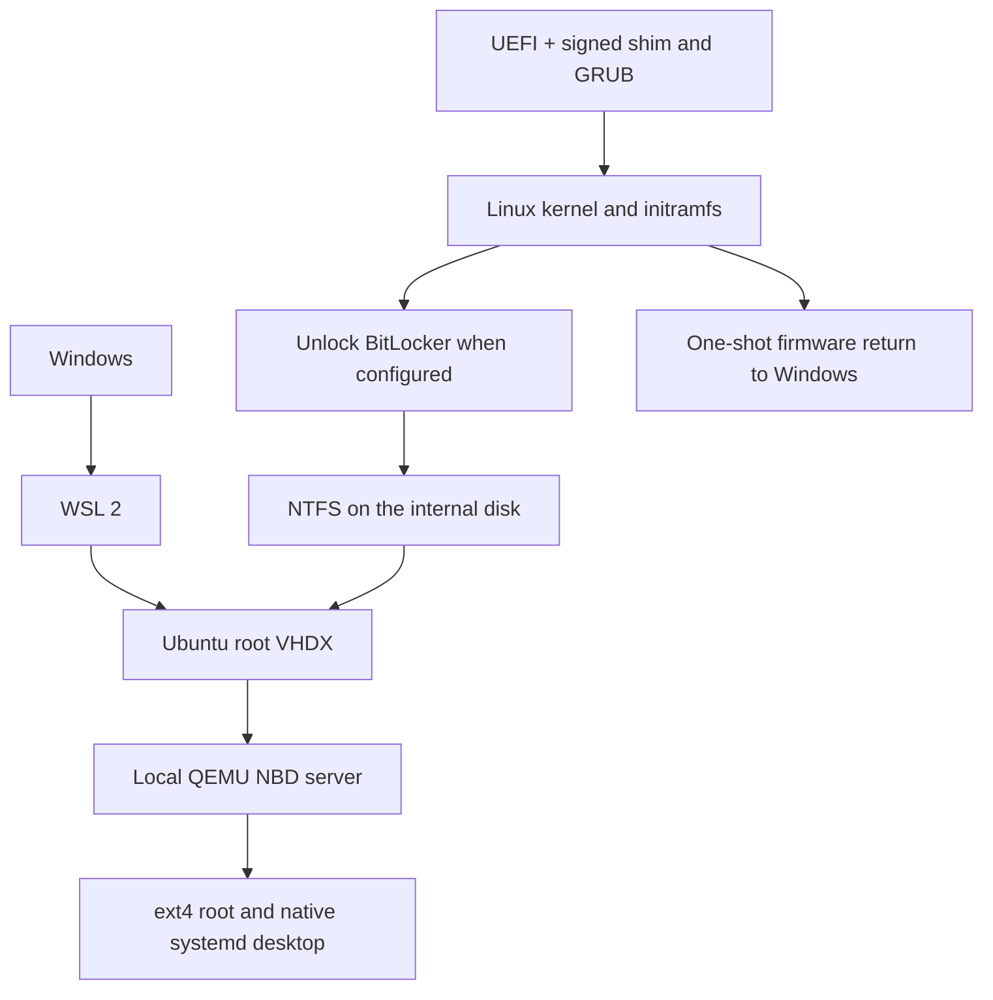

# One Ubuntu. Two ways in.

**Bring your WSL Ubuntu to the desktop.** Use the same Linux environment inside Windows with WSL 2, then restart into a native Ubuntu desktop on the same laptop. Your files and installed software live in one VHDX on the internal Windows drive.

This project reconstructs the boot setup behind a working prototype. It includes tools to clone an existing WSL distro, build a native boot payload, check the shared root, and return to Windows. The generalized implementation is experimental, so start with a disposable VM and the read-only boot check described below.

## Architecture

WSL and native Linux use the **same clone**, at different times. The initramfs detects a specific GPT partition by PARTUUID, unlocks it when necessary, checks NTFS write readiness, verifies and loads a driver archive, and attaches the VHDX. A read-only entry checks this path first. Native shutdown returns to the initramfs, unmounts the Linux root and NTFS, stops the NBD daemon, and powers off or reboots.

The firmware path back to Windows identifies the direct Windows Boot Manager entry and sets the UEFI `BootNext` variable for a single reboot.

## Important limits

- Supported design target is x86-64 UEFI, Ubuntu with systemd, a fixed GPT/NTFS Windows volume, WSL 2, and a signed Ubuntu kernel, shim and GRUB. Kernel modules and firmware must match the native kernel and hardware.
- Shutdown Windows completely before native boot. Disable Windows Fast Startup or use a full shutdown. Never run WSL and native Linux against the same VHDX at once. Do not mount hibernated or dirty NTFS read-write.
- Windows and Linux may need different networking, DNS, graphics, hardware drivers, and service startup behavior. The supplied boot entry masks selected services in native mode only. Adapt those masks deliberately. Do not use hibernation with the shared root. Only the single host NTFS volume is handled by the generic boot scripts.
- Kernel updates do not automatically refresh this boot payload. Rebuild, test, and install a matching kernel, initramfs and driver archive together.

## Contents

- [`windows/New-HybridClone.ps1`](windows/New-HybridClone.ps1) exports a stopped WSL 2 distro to a separate VHDX.
- [`tools/build.py`](tools/build.py) builds a per-machine Linux initramfs, driver archive, signed-kernel bundle and firmware return helper.
- [`tools/install-efi.sh`](tools/install-efi.sh) installs files on an explicitly selected, verified ESP. It refuses existing Ubuntu or hybrid boot directories.
- [`boot/`](boot/) contains the early boot, NBD lifecycle, shutdown and firmware handoff sources.
- [`docs/SETUP.md`](docs/SETUP.md) describes the complete setup and recovery process.
- [`docs/TESTING.md`](docs/TESTING.md) records tested behavior, limitations, and disposable testing.

## References

- [Microsoft WSL export and import commands](https://learn.microsoft.com/en-us/windows/wsl/basic-commands)
- [Ubuntu cryptsetup manual, including BitLocker support](https://manpages.ubuntu.com/manpages/noble/man8/cryptsetup.8.html)
- [QEMU NBD documentation](https://www.qemu.org/docs/master/tools/qemu-nbd.html)
- [Linux initramfs documentation](https://docs.kernel.org/filesystems/ramfs-rootfs-initramfs.html)
