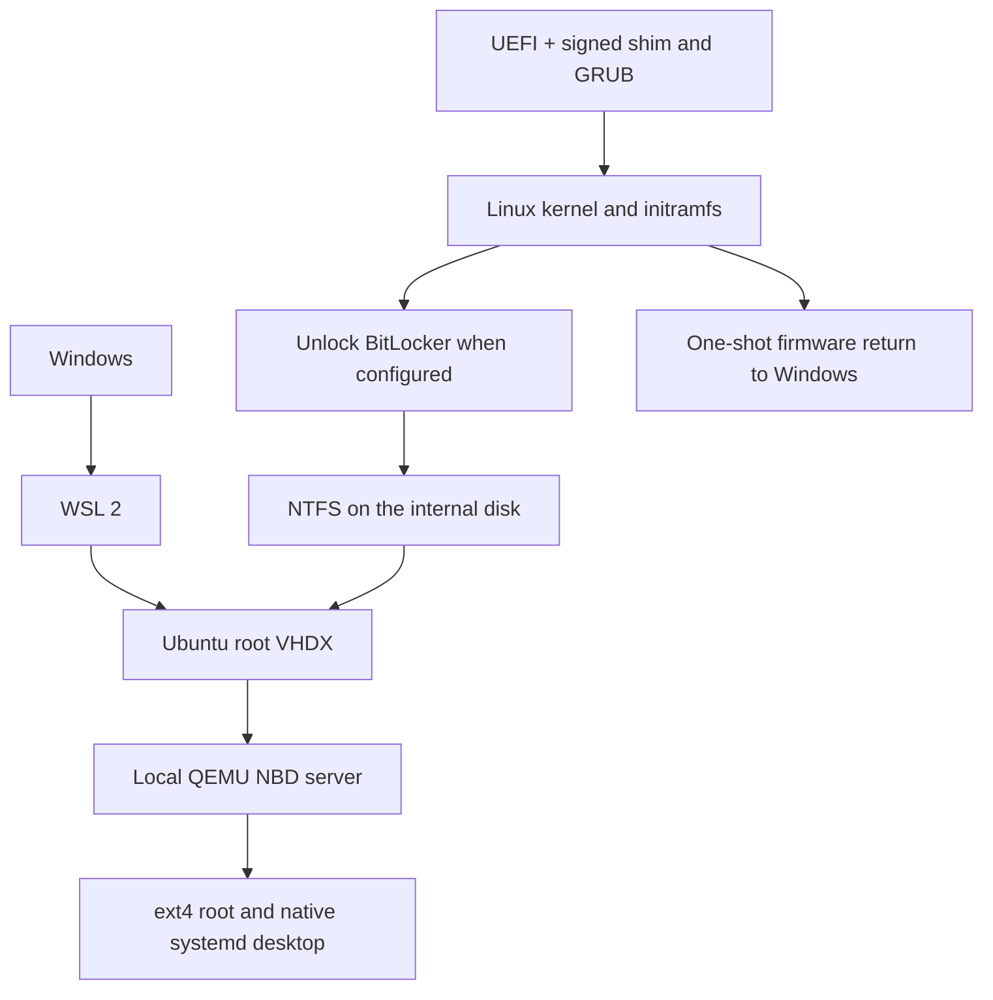

# WSL Ubuntu as a native-boot system

This project reconstructs an experimental hybrid setup that runs a single Ubuntu root filesystem in two modes: as a WSL 2 distro on Windows and as a native UEFI boot on the same laptop. The filesystem remains in a VHDX on the internal Windows NTFS volume. Native Linux reaches it through a local QEMU NBD server.

The original prototype booted a cloned WSL Ubuntu on one Secure Boot laptop, including a BitLocker-encrypted Windows volume. It demonstrated a persistent native desktop, a return to WSL, and a Windows firmware handoff. The generalized code in this repository is a reconstruction, not the original machine-specific installer. Hardware, firmware, encryption policy, and Windows versions differ. Treat it as experimental until you have reproduced the disposable VM tests and a read-only boot on your hardware.

**Make an independent, restorable backup before experimenting.** The clone, Windows, and the native filesystem can all depend on the same physical disk and NTFS volume. A clone on that disk is not protection against disk failure or damage to that volume. Keep the Windows BitLocker recovery key accessible independently of the laptop. Do not post recovery keys, vaults, disk images, or machine-specific configuration in issues.

## Architecture

WSL and native Linux use the **same clone**, at different times. The initramfs detects a specific GPT partition by PARTUUID, unlocks it when necessary, checks NTFS write readiness, verifies and loads a driver archive, and attaches the VHDX. A read-only entry checks this path first. Native shutdown returns to the initramfs, unmounts the Linux root and NTFS, stops the NBD daemon, and powers off or reboots.

The firmware path back to Windows identifies the direct Windows Boot Manager entry and sets the UEFI `BootNext` variable for a single reboot. On the original laptop, directly chainloading Windows through GRUB triggered BitLocker recovery and Windows Hello reconfiguration. Firmware behavior still varies.

## Important limits

- Supported design target is x86-64 UEFI, Ubuntu with systemd, a fixed GPT/NTFS Windows volume, WSL 2, and a signed Ubuntu kernel, shim and GRUB. Kernel modules and firmware must match the native kernel and hardware.
- Shutdown Windows completely before native boot. Disable Windows Fast Startup or use a full shutdown. Never run WSL and native Linux against the same VHDX at once. Do not mount hibernated or dirty NTFS read-write.
- The ESP and initramfs are normally unencrypted. A signed kernel or shim does **not** automatically authenticate a separate initramfs, GRUB configuration, or runtime driver archive. The included checksum detects accidental changes, not an attacker who can change both the data and checksum. Physical attacks against the boot chain may capture an entered recovery key. Design a measured or signed boot chain if your threat model requires it.
- A LUKS vault of Windows recovery keys protected by a short boot password weakens protection against offline guessing of that password. The recommended default prompts for the existing recovery password without storing it in the repository or boot files. TPM sealing and automatic recovery-key management are not implemented here.
- Windows and Linux may need different networking, DNS, graphics, hardware drivers, and service startup behavior. The supplied boot entry masks selected services in native mode only. Adapt those masks deliberately. Do not use hibernation with the shared root. Only the single host NTFS volume is handled by the generic boot scripts.
- Kernel updates do not automatically refresh this boot payload. Rebuild, test, and install a matching kernel, initramfs and driver archive together.
- Modern Microsoft/firmware Secure Boot trust, dbx revocations and SBAT policy vary. A trusted shim in a VM does not prove a physical machine trusts it. Firmware or boot-chain changes can trigger BitLocker recovery.

## Contents

- [`windows/New-HybridClone.ps1`](windows/New-HybridClone.ps1) exports a stopped WSL 2 distro to a separate VHDX.
- [`tools/build.py`](tools/build.py) builds a per-machine Linux initramfs, driver archive, signed-kernel bundle and firmware return helper.
- [`tools/install-efi.sh`](tools/install-efi.sh) installs files on an explicitly selected, verified ESP. It refuses existing Ubuntu or hybrid boot directories.
- [`boot/`](boot/) contains the early boot, NBD lifecycle, shutdown and firmware handoff sources.
- [`docs/SETUP.md`](docs/SETUP.md) describes the complete setup and recovery process.
- [`docs/TESTING.md`](docs/TESTING.md) records tested behavior, limitations, and disposable testing.

This project does not collect data or provide a cloud service. Review the source and all downloaded packages before running it.

## References

- [Microsoft WSL export and import commands](https://learn.microsoft.com/en-us/windows/wsl/basic-commands)
- [Ubuntu cryptsetup manual, including BitLocker support](https://manpages.ubuntu.com/manpages/noble/man8/cryptsetup.8.html)
- [QEMU NBD documentation](https://www.qemu.org/docs/master/tools/qemu-nbd.html)
- [Linux initramfs documentation](https://docs.kernel.org/filesystems/ramfs-rootfs-initramfs.html)
- [Microsoft BitLocker recovery guidance](https://support.microsoft.com/windows/find-your-bitlocker-recovery-key-6b71ad27-0b89-ea08-f143-056f5ab347d6)
